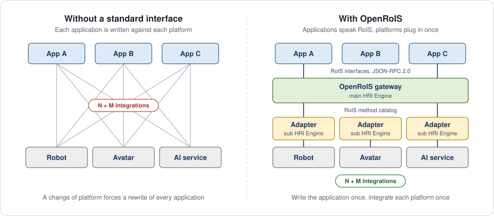
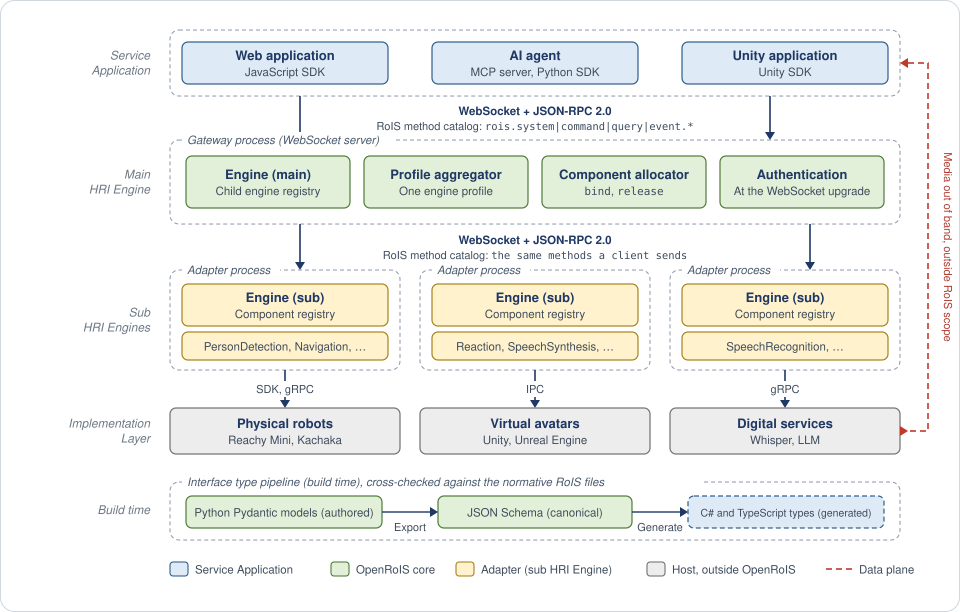
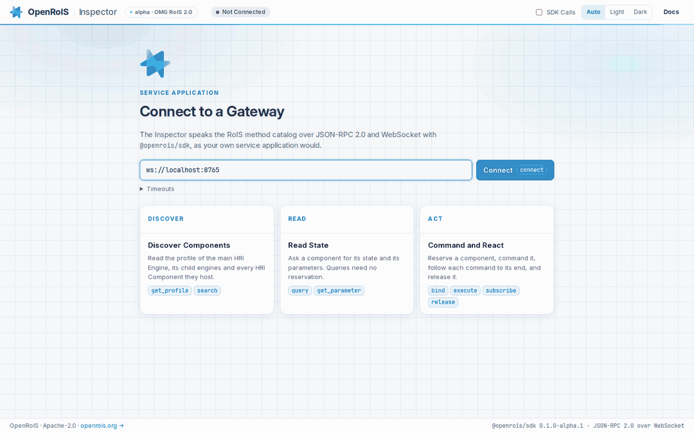

<p align="center">
  <a href="https://openrois.org/">
    
  </a>
</p>

<h1 align="center">OpenRoIS</h1>

<p align="center">
  <strong>Open-source middleware implementing the OMG Robotic Interaction Service (RoIS) Framework 2.0</strong><br>
  Write a service application once. Run it on physical robots, virtual avatars, and digital services, or let an AI agent drive them.
</p>

<p align="center">
  <a href="https://www.omg.org/spec/RoIS/2.0"></a>
  <a href="https://arxiv.org/abs/2609.21178"></a>
  <a href="LICENSE"></a>
  <a href="#project-status"></a>
  
  
  
  
</p>

<p align="center">
  <a href="https://openrois.org/">Website</a> ·
  <a href="https://github.com/openrois">OpenRoIS GitHub Organization</a> ·
  <a href="https://arxiv.org/abs/2609.21178">OpenRoIS arXiv Preprint</a> ·
  <a href="https://www.omg.org/spec/RoIS/2.0">OMG RoIS Specification</a> ·
  <a href="#quickstart">Quickstart</a> ·
  <a href="docs/white-paper.md">White Paper</a> ·
  <a href="docs/architecture.md">Architecture</a> ·
  <a href="docs/roadmap.md">Roadmap</a> ·
  <a href="CONTRIBUTING.md">Contributing</a>
</p>

---

## Overview

Service applications for human-robot interaction are usually written against the
hardware-specific interface of one platform, so a change of hardware forces a rewrite
of the application. The [OMG RoIS Framework 2.0](https://www.omg.org/spec/RoIS/2.0)
addresses this fragmentation with a platform-independent model: applications talk to
HRI Engines through five standard interfaces and exchange symbolic messages such as
"a person was detected" or "navigate to the kitchen", never raw sensor data or motor
commands.

A specification alone does not provide the maintained implementation, SDKs, and
adapters that adoption requires. **OpenRoIS is an openly developed implementation of
RoIS 2.0** that carries the standard from specification to practice, for physical
robots, virtual avatars, and digital services alike.

<p align="center">
  <picture>
    <source media="(prefers-color-scheme: dark)" srcset="docs/assets/openrois-concept-dark.svg">
    
  </picture>
</p>

## Key Features

- **Recursive engine.** A single `Engine` class realizes both the main and the sub HRI
  Engine roles defined by RoIS. The gateway and every adapter share one dispatch
  implementation.
- **The RoIS method catalog at every hop.** The engine reaches every component with the
  operations of the RoIS method catalog, whether the component runs in its own process
  or behind a child engine, which it calls with the same requests a client sends. ROS 2,
  gRPC, game engines, and cloud APIs stay inside components, so adding a paradigm never
  touches the core.
- **JSON-RPC 2.0 over WebSocket.** Every operation of the System, Command, Query and
  Event interfaces maps to a namespaced method (`rois.system.*`, `rois.command.*`,
  `rois.query.*`, `rois.event.*`). Streaming is the AudioStreaming and VideoStreaming
  components, whose messages ride the same interfaces. The control plane works from
  browsers and across the internet.
- **The RoIS behavior, not only the types.** The engine implements the interfaces,
  profiles and common messages of RoIS (conformance points CP1 to CP3) as
  [rois-reference §16](docs/rois-reference.md#16-known-normative-divergences) records
  them: sessions that connect first, binds whose cardinality follows each component's
  RoSO function, command ids the engine assigns, parallel branches, command timeouts,
  the RoIS_Common commands for every component, and errors pushed with `notify_error`.
  OpenRoIS makes no conformance claim yet.
- **Single source of truth for types.** RoIS types are authored once as Python
  Pydantic models, exported to JSON Schema, and generated into TypeScript and C#.
  An XML codec reads and writes RoIS component and engine profiles, and all 18 standard
  profiles ship as constants. Tests check the models against the normative RoIS XML
  profiles and schema.
- **Profile-driven applications.** Clients discover components, queries, commands, and
  events from the engine profile at runtime, so one application works with any robot
  behind the gateway.
- **Decorator-based components.** Adapter authors declare a component with
  `@component`, mark its RoIS messages with `@command`, `@query` and `@event`, share a
  robot connection between components as a `Resource`, read their settings from
  `adapter.yaml`, and write only the code that talks to their robot.

## Architecture

<p align="center">
  <picture>
    <source media="(prefers-color-scheme: dark)" srcset="docs/assets/openrois-architecture-dark.svg">
    
  </picture>
</p>

| RoIS concept | OpenRoIS realization |
|--------------|----------------------|
| Service Application | Your application, built with the JavaScript, Python, or Unity client SDK |
| Main HRI Engine | The gateway process: `Engine` with child engines, behind a WebSocket server |
| Sub HRI Engine | An adapter process: `Engine` with local components, connected to the gateway |
| HRI Component | A class decorated with `@component`, hosted by an adapter |
| RoIS interfaces | JSON-RPC 2.0 methods in the `rois.*` namespaces |

Read the [white paper](docs/white-paper.md) for the design rationale and the full wire
protocol, and the [architecture document](docs/architecture.md) for implementation
details.

## Quickstart

Run a gateway with a simulated robot behind it, and explore it in the browser. All you need
is [Docker](https://docs.docker.com/get-started/get-docker/) with Compose.

```bash
git clone https://github.com/openrois/openrois.git
cd openrois
docker compose up --build
```

Then open [http://localhost:8080/?autoconnect=1](http://localhost:8080/?autoconnect=1). The
[OpenRoIS Inspector](apps/inspector/README.md) connects to the gateway on
`ws://localhost:8765` and shows the engines behind it and their components:
`mock/navigation`, `mock/person_detection`, `mock/system_information` and the test fixture
`mock/fault`, served by the mock adapter, an engine of its own below the gateway. Bind a
component, run its commands one at a time or as a sequence with concurrent branches, query
it, subscribe to its events, and follow every JSON-RPC message in the activity log, with the
`@openrois/sdk` code for each action. Nothing in the Inspector is specific to the components
on the other side.

<p align="center">
  
</p>

<p align="center"><sub>Recorded from this quickstart, with the mock adapter and no robot attached.</sub></p>

`python testing/conformance/wire_check.py` checks the same stack from the command line,
after `pip install websockets`. To develop a client without Docker, run the gateway and the
[mock adapter](testing/mock-adapter/README.md) as Python processes.

## Usage

### Write a Service Application

Three client SDKs expose the RoIS interfaces, with one method per operation of the RoIS
method catalog. All three are Alpha, pre-1.0, unstable API.

| SDK | For | Install |
|-----|-----|---------|
| [JavaScript](sdk/javascript/README.md) | Browsers and Node.js 22.12 or later | `npm install @openrois/sdk` |
| [Python](sdk/python/README.md) | Asyncio on Python 3.12 or later | `pip install openrois-sdk` |
| [Unity](sdk/unity/README.md) | Unity 6000.0 and later | By Git URL: `https://github.com/openrois/openrois.git?path=sdk/unity#sdk-unity-v0.1.0` |

```ts
import { RoISClient, componentRef, componentType } from "@openrois/sdk";

const client = await RoISClient.connect("ws://localhost:8765");

// Find a navigation component on any connected robot, then select it by ref.
const [nav] = await client.search(componentType({ authority: "OMG", code: "Navigation" }));
const target = componentRef(nav);

// Query state synchronously.
const status = await client.query("component_status", target);

// Subscribe to events.
client.on("rois.event.notify_event", ({ event_type, results }) => {
  console.log(event_type, results);
});
await client.subscribe("reached_target", target);

// Record how each command ends before running any, because a command can end before
// the reply to execute() is read.
const statuses = new Map<string, string>();
const waiters = new Map<string, () => void>();
client.on("rois.command.completed", ({ command_id, status }) => {
  statuses.set(command_id, status);
  waiters.get(command_id)?.();
});

// Bind the component, configure it, command it, wait for it, then release it. Every
// command operation needs a bind, and the engine assigns the command ids.
await client.bind(nav);
await client.setParameter(nav, [
  { name: "target_positions", data_type_ref: "string[]", value: '["kitchen"]' },
]);
const [commandId] = await client.execute([{ component_ref: nav, command_type: "start" }]);
// Wait here, because release aborts a running command, which then ends with ABORT.
if (!statuses.has(commandId)) {
  await new Promise<void>((resolve) => waiters.set(commandId, resolve));
}
console.log(statuses.get(commandId));
await client.release(nav);

await client.disconnect();
```

### Write a Component for Your Robot

A component translates RoIS operations into calls to your platform, whether that is a
ROS 2 action, a gRPC service, or an HTTP API. The adapter hosts it in a sub HRI Engine
and connects it to the gateway.

```python
from openrois.components.core import Component, command, component, event
from openrois.interfaces.components import NAVIGATION_PROFILE


@component(NAVIGATION_PROFILE)
class Navigation(Component):
    def __init__(self, robot_url: str) -> None:
        self._robot_url = robot_url

    async def connect(self) -> None:
        self._robot = await MyRobotClient.open(self._robot_url)

    @command("start")
    async def start(self) -> None:
        target = self.parameters["target_positions"][0]
        await self._robot.go_to(target)  # the command runs until the robot arrives
        self.emit("reached_target", target=target, is_final_target=True)

    @event("reached_target")
    async def reached_target(self) -> None:
        pass  # start emits the event when the robot arrives.
```

The engine stores the parameters, answers `component_status`, serves `stop`, `suspend`
and `resume` from the RoIS_Common default, and reports the end of each command with
`rois.command.completed`. Host the component in an engine and connect it to
the gateway:

```python
from openrois.engine import Engine, WsClient

engine = Engine("robot_1")
engine.add_component("navigation", Navigation("http://192.168.0.10:8080"))
WsClient(engine, "ws://gateway.example.com:8765").run()
```

Clients see the component as `robot_1/navigation`.

See [`examples/adapter-template`](examples/adapter-template) for a complete starting
point, with a shared `Resource` and settings from `adapter.yaml`.

### Robot Adapters

Each robot's components live in its adapter repository, not in this one. The reference
adapter is [openrois-adapter-reachy-mini](https://github.com/openrois/openrois-adapter-reachy-mini),
which serves a Pollen Robotics Reachy Mini, real or simulated, with PersonDetection,
Reaction, SpeechSynthesis and SystemInformation from its
`openrois.components.reachy_mini` package. Coarobo maintains an adapter for the Kachaka
robot.

## Project Status

OpenRoIS is **alpha, pre-1.0, with an unstable API**. The engine implements the RoIS
interfaces, profiles and common messages (CP1 to CP3), with the exceptions that
[rois-reference §16](docs/rois-reference.md#16-known-normative-divergences) records, and
makes no conformance claim. The rest of the RoIS surface is being built in the open.

| Milestone | Status | What it delivers |
|-----------|--------|------------------|
| **`v0.1.0`** (November 2026) |  | Every package at `0.1.0`, released together. A physical Reachy Mini and a simulated one behind one gateway, driven by one application and by an AI agent |
| **`v0.2`** |  | RoIS conformance: components declared by XML profiles at run time, the types checked against the normative RoIS files on every change, a test suite that adapter authors run against their own adapter, and a conformance claim. Applications and engines that recover when a gateway or an adapter restarts |
| **`v0.3`** |  | A physical robot and a virtual avatar behind one gateway, controlled by one application that does not know which is which |
| **`v0.4`** |  | Authentication at the WebSocket upgrade and authorization per RoIS operation. Until then, a reverse proxy in front of the gateway terminates TLS ([SECURITY.md](SECURITY.md)). An adapter for a second robot |
| **`v0.5`** |  | Media for the AudioStreaming and VideoStreaming components. OpenRoIS does not prescribe a media transport: a streaming component returns a descriptor of its stream, and an optional WebRTC integration serves deployments that have none |
| **`v1.0`** |  | A stable API, and the first release with semantic versioning guarantees. It stands on the milestones above: the conformance claim, authentication, and reference adapters for two robots and a virtual avatar, on Linux, Windows and macOS |
| Beyond `v1.0` |  | The remaining basic RoIS HRI Components, each released when it is ready. A registry of community components and adapters, and a Hub that shows operators the adapters, sessions and health of a deployment |

The [roadmap](docs/roadmap.md) also describes each layer of the stack.

## Repository Layout

```
openrois/
├── interfaces/          RoIS types: Python models, JSON Schema, generated TypeScript and C#
├── engine/              Recursive Engine, WebSocket server and client (openrois-engine)
├── components/
│   └── core/            Component SDK: decorators, resources, RoIS_Common default (openrois-components-core)
├── sdk/
│   ├── javascript/      Client SDK for web and Node.js (@openrois/sdk)
│   ├── python/          Python client SDK (openrois-sdk)
│   └── unity/           Client SDK for Unity (org.openrois.sdk)
├── services/
│   ├── gateway/         Gateway process and container image (openrois-gateway)
│   └── mcp/             MCP server for AI agents (openrois-mcp)
├── apps/
│   └── inspector/       OpenRoIS Inspector: explore and drive the engines behind a gateway
├── examples/
│   └── adapter-template/  Starting point for a new robot adapter
├── testing/
│   ├── mock-adapter/    Adapter with simulated components
│   ├── conformance/     The scenario list for clients of a gateway
│   └── unity-harness/   Runs the Unity SDK in real players and in the Editor
├── docs/                White paper, architecture, roadmap, RoIS reference
└── compose.yaml         The gateway, the mock adapter and the Inspector, in Docker Compose
```

## Documentation

| Document | Contents |
|----------|----------|
| [White paper](docs/white-paper.md) | Motivation, design decisions, wire protocol, deployment topologies |
| [Architecture](docs/architecture.md) | Engineering design of the engine, adapters, and components |
| [RoIS reference](docs/rois-reference.md) | Summary of the OMG RoIS Framework 2.0 specification |
| [Roadmap](docs/roadmap.md) | Milestones, their status, and the layers of the stack |
| [openrois.org](https://openrois.org/) | The same documentation as a website |

## Development

The RoIS types flow in one direction: **Python models, then JSON Schema, then TypeScript
and C#.** Edit the Python models in `interfaces/python`, regenerate, and never edit the
generated files by hand.

| Stack | Directory | Commands |
|-------|-----------|----------|
| Python types | `interfaces/python` | `pip install -e ".[dev]"`, `pytest`, `mypy src/`, `ruff check src/` |
| TypeScript types | `interfaces/typescript` | `npm install`, `npm run build`, `npm test`, `npm run test:package` |
| C# types | `interfaces/csharp` | `dotnet build`, `dotnet test` |
| JavaScript SDK | `sdk/javascript` | `npm install`, `npm run build`, `npm test` |
| Python client SDK | `sdk/python` | `pytest`, `mypy`, `ruff check src/ tests/` |
| Unity SDK | `sdk/unity/Tests~` | `dotnet test` |
| Engine | `engine` | `pytest`, `mypy`, `ruff check src/ tests/` |
| Component SDK | `components/core` | `pytest`, `mypy`, `ruff check src/ tests/` |
| Mock adapter | `testing/mock-adapter` | `pytest`, `mypy`, `ruff check .` |
| Gateway | `services/gateway` | `pytest`, `mypy`, `ruff check src/ tests/` |
| MCP server | `services/mcp` | `pytest` (with `OPENROIS_GATEWAY_URL` set, also against a live gateway), `mypy`, `ruff check src/ tests/` |

[`AGENTS.md`](AGENTS.md) documents the conventions and the generation pipeline in
detail.

## Contributing

Contributions are welcome. An adapter for a new robot, with its components in its own
repository, is the natural entry point, and the [roadmap](docs/roadmap.md) lists work
items that can be taken up in parallel. Please read the [contributing
guide](CONTRIBUTING.md) before opening a pull request.

## Citation

The position paper describing OpenRoIS is accepted at the 2027 IEEE/SICE International
Symposium on System Integration (SII 2027), held in Kobe in January 2027. Until it appears
in the proceedings, please cite its preprint on arXiv,
[arXiv:2609.21178](https://arxiv.org/abs/2609.21178), with the DOI
[10.48550/arXiv.2609.21178](https://doi.org/10.48550/arXiv.2609.21178).

```bibtex
@misc{carrera2026openrois,
  author        = {Carrera Villalobos, Sebastian and Arellano, Christopher Nolan and
                   Hitzmann, Arne and Morais Brito, Edilson and Utsumi, Akira and
                   Horikawa, Yukiko and Miyashita, Takahiro and Ishiguro, Hiroshi and
                   El Hafi, Lotfi},
  title         = {{OpenRoIS}: A Community-Driven Open-Source Middleware Implementing
                   the Robotic Interaction Service ({RoIS}) Framework for Physical
                   Robots, Virtual Avatars, and {AI} Agents},
  year          = {2026},
  eprint        = {2609.21178},
  archivePrefix = {arXiv},
  primaryClass  = {cs.RO},
  doi           = {10.48550/arXiv.2609.21178},
  url           = {https://arxiv.org/abs/2609.21178},
  note          = {Accepted at the 2027 IEEE/SICE International Symposium on
                   System Integration (SII 2027), to appear}
}
```

Please also cite the software using the metadata in [`CITATION.cff`](CITATION.cff), which
carries the paper as its preferred citation. The website has the full
[citation guidance](https://openrois.org/docs/project/citing).

## License

OpenRoIS is licensed under the [Apache License 2.0](LICENSE). Copyright 2026 Coarobo GK.
OpenRoIS is developed by Coarobo GK and the OpenRoIS community. OpenRoIS is a trademark
of Coarobo GK. RoIS is a trademark of the Object Management Group.
