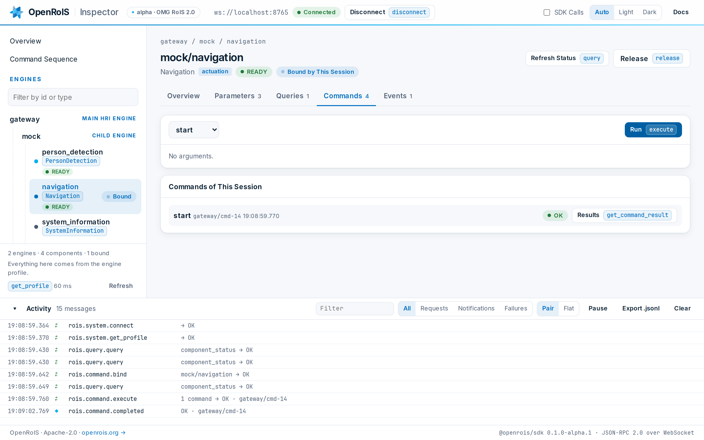

# OpenRoIS Inspector

A RoIS service application for the browser, built on
[`@openrois/sdk`](../../sdk/javascript/README.md). It connects to a gateway, shows the
engines behind it and their components, and drives them the way your own application would,
with every JSON-RPC message of the session in view.

<picture>
  <source media="(prefers-color-scheme: dark)" srcset="../../docs/assets/inspector-dark.png">
  
</picture>

## Run It

From the repository root, with Docker and nothing else installed:

```bash
docker compose up --build
```

Open [http://localhost:8080/?autoconnect=1](http://localhost:8080/?autoconnect=1). The Inspector
connects to the gateway on `ws://localhost:8765`, with the mock adapter behind it. Without
`autoconnect`, it opens on the connect screen. To inspect another gateway, enter its URL there,
or open the page with `?url=ws://host:port`. The Inspector remembers the last gateway it
reached.

## What It Shows

| Area | What you do there |
|------|-------------------|
| Overview | See the main HRI Engine you reached and what the session listens for, then try the stack with guided cards: read a position, watch for people, drive to a target (bind, start, release), and open an example sequence. The cards find components by RoIS type, so they work against any gateway that has them. |
| Engines | The main HRI Engine, its child engines and the HRI Components each one hosts, with their type, function, `component_status`, and whether this session holds them. A filter narrows the tree by id or type, and the tree follows `rois.system.profile_changed`. |
| Component | Its profile, its parameters (`get_parameter`, `set_parameter`), its queries with their arguments, its commands followed to `rois.command.completed` with `get_command_result`, and its events with `subscribe` and `get_event_detail`. Every button names the RoIS method it calls. |
| Command Sequence | One `rois.command.execute` built from commands in order and concurrent groups whose branches run at the same time, each step with arguments and a delay. The Inspector lists what keeps the sequence from running, shows the exact request, and follows every command id to its completion. A group shows the worst status of its branches. |
| Activity | Every request, response and notification. Pair shows each request with its response, and Flat shows every frame. Filter by method or component, pause, export the session as JSON Lines, and open a row to its raw JSON-RPC. A `rois.system.notify_error` row reads its detail with `get_error_detail`. |

With SDK Calls on, each view also shows the `@openrois/sdk` TypeScript that does the same,
ready to copy. Nothing in the Inspector is specific to a robot: every form comes from the
component profiles. It has a light and a dark theme, and follows the system setting by
default.

## Fonts

The Inspector bundles [Inter](https://github.com/rsms/inter) (variable, v4.1) and
[JetBrains Mono](https://github.com/JetBrains/JetBrainsMono) (Regular and Medium, v2.304) in
`public/fonts`, so it matches openrois.org without loading anything from another host. Both are
third-party fonts under the SIL Open Font License 1.1 (OFL-1.1), with their license next to
them. The repository's NOTICE lists them.

## Develop

The Inspector links the types and the SDK of this repository, so build both first:

```bash
(cd interfaces/typescript && npm install && npm run build)
(cd sdk/javascript && npm install && npm run build)

cd apps/inspector
npm install
npm run dev        # http://localhost:5173, against a gateway on ws://localhost:8765
npm test           # the sequence and engine models
npm run typecheck
npm run build      # the static files that the image serves
```

`VITE_GATEWAY_URL` at build time changes the gateway the page connects to first.

## Where It Fits

| Part | RoIS role |
|------|-----------|
| `apps/inspector` | Service application, the side that uses components |
| `services/gateway` | Main HRI Engine |
| `testing/mock-adapter` | Sub HRI Engine, a working adapter with no robot |
| `examples/adapter-template` | Sub HRI Engine, a blank starting point |

## License

Apache-2.0.
